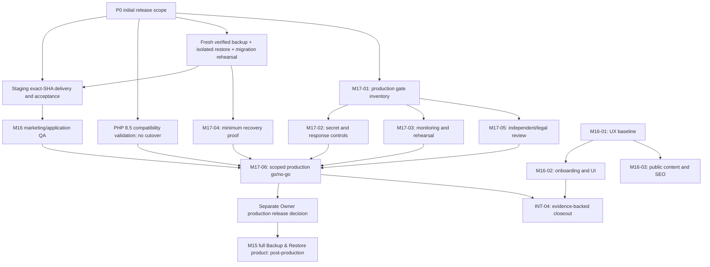

# WP CareGrid — Master Roadmap & Parallel Integration Plan

**Planning baseline:** 2026-11-04
**Repository:** `zsoltacsai/wpcaregrid`
**Authoritative branch:** `claude/ecstatic-wozniak-oemyuf`
**Verified source baseline:** `7355788882e026db7c4a6d37db2b957740b5f385`
**Baseline CI:** run [41747134447](https://github.com/zsoltacsai/wpcaregrid/actions/runs/41747134447), exact merge SHA, 38/38 checks PASS
**Marketing E2E:** run [41748568634](https://github.com/zsoltacsai/wpcaregrid/actions/runs/41748568634), exact SHA, PASS
**Status:** Owner-approved roadmap reprioritization; this document does not authorize a staging or production operation.

## 1. Purpose and planning rules

This document records the current release sequence after the Owner's 2026-11-04 decisions. The first release target is a HU/EN marketing-only MVP. Paid service activation, customer registration and live payments remain disabled until service, financial, operational and release conditions pass and the applicable Owner authorization is recorded. Full customer-facing M15 Backup & Restore functionality moves to a later milestone. Minimum infrastructure backup, recoverability and rollback controls remain mandatory for the broad staging release and any applicable production release.

Keep the established security boundaries:

- Owner and Operator functions remain server-authorized; tenant isolation and subscription enforcement are not replaced by UI checks.
- No generic scanner override, arbitrary remote execution, or synthetic-fixture identity reuse.
- A verified backup is required before an operation that can change a site. Restore rehearsal stays on an isolated staging copy.
- Never enable automatic remediation for a pilot by implication.
- Unknown, stale, or unsupported compatibility evidence remains fail-closed for high-risk operations.
- No production deployment, live payment, credential creation, customer-data operation, DNS change, or server configuration change is authorized by this plan.
- Do not remove historical reports. Update the current status record only through the integration owner after evidence is available.

## Owner decision — marketing MVP, paid-service gate and M15 boundary (2026-11-04)

The Owner approved a marketing-only first MVP. This supersedes the earlier assumption that the first production release itself should take real subscriptions. It does not make a broad application deployment safe by itself, authorize production, or waive staging recovery requirements.

1. **P0 — marketing-only MVP:** synchronize and accept the exact approved release on staging, then prepare the public HU/EN marketing experience. Registration, account activation, checkout, payment, customer service delivery and production activation must stay disabled. Pricing content, if shown, is informational and must not imply that a customer can purchase or receive an unavailable service.
2. **Minimum infrastructure recovery gate:** because the target staging release is broad and includes application/database changes, create a fresh verified application/configuration/database backup; preserve matching `.env`/`APP_KEY` using the approved protected process; prove an isolated restore; test the seven target migrations on a restored disposable copy; and retain an exact-SHA rollback and gated recovery procedure. Backup creation/archive integrity alone is not restore proof. This gate remains mandatory before staging synchronization and other state-changing release operations.
3. **Paid service activation — later, separately gated:** choose only a package whose advertised capabilities have verified technical delivery, staffed operations, financial/accounting approval, support and recovery evidence. Keep customer registration, Stripe Checkout, webhook provisioning and production service activation disabled until those conditions pass. Sandbox tests may validate code paths; no live transaction is authorized.
4. **M15 product milestone:** full customer-facing Backup & Restore, customer-facing entitlements/retention, browsing, restore-provider/isolation workflows and product acceptance remain later scope. Keep those interfaces and capabilities unavailable until M15 acceptance, without removing the separate infrastructure recovery gate.
5. **M17 controls and PHP policy:** security, legal/accounting, monitoring, secrets/access, runtime, privacy and production release gates apply to the actual enabled scope. Laravel server CI must cover PHP 8.4 and 8.5; PHP 8.5 compatibility is a validation target, not a cutover authorization. PHP 8.5 staging/production cutover remains NO-GO. The Connector matrix is unchanged.

### Restore-gate options

| Candidate | Compliance and trade-off | Decision |
|---|---|---|
| Authorized encrypted transfer to isolated WSL/MySQL lab | Can prove restore without changing staging MySQL, but moves confidential database ciphertext outside the staging boundary and requires an officially authorized transfer channel. Current status: `BLOCKED_EXTERNAL_AUTHORITY`; do not use another transport. | Keep as fallback if the platform cannot provide an isolated restore target in the staging infrastructure. |
| Administrator-provided isolated restore environment in staging infrastructure | Avoids off-host transfer and is the preferred minimum-change path if an already supported, separately isolated environment can be provided. It must have a disposable datadir/instance, no access to or mutation of the live database, no shared socket, no public/TCP exposure, bounded credentials, exact cleanup evidence, and no AppArmor or policy weakening. | **Preferred next executable action:** ask the staging administrator to provide a one-use isolated MySQL 8.4.11 restore target within the existing staging security boundary and run the restore there. If provision requires a new policy exception or weakening isolation, stop and retain NO-GO. |

Neither candidate is currently evidenced as available. The staging restore gate remains blocked until one approved path is provisioned and passes the actual-backup restore test.

## 2. Baseline and current evidence

### MVP launch audit and staging synchronization — 2026-11-04

**Evidence boundary:** repository facts below are from source at `7355788882e026db7c4a6d37db2b957740b5f385` and accepted CI/E2E evidence. Environment facts are separately labeled. CI proves the exercised source/test paths, not current staging or production behavior.

| Capability | Class | Verified evidence | Still unverified / release condition |
|---|---|---|---|
| Public HU/EN marketing pages, informational pricing, navigation and contact/conversion links | A — launch-critical | Localized routes/views and marketing E2E exist; exact-source Marketing E2E run `41748568634` PASS. | Staging is still `761e0e5d37558da808ac961ca2d2a68b4ffab0db`; actual post-sync browser acceptance is outstanding. Keep checkout/registration destinations inaccessible and copy informational only. |
| Pricing catalogue and subscription identifiers | A for safe informational content; paid checkout is C for this MVP | `config/pricing.php` is authoritative: `wordpress.basic`, `wordpress.business`, `wordpress.secure`, and corresponding `woocommerce.*` IDs. HU monthly prices are 8,990 / 18,990 / 28,990 HUF for WordPress and 14,900 / 24,900 / 39,900 HUF for WooCommerce. Localized labels are Basic, Business and Secure. | “Standard” and “Premium” are not current labels/IDs. The 39,900 HUF price maps to `woocommerce.secure`. Paid pricing claims must be clearly non-purchasable until service/financial/operations gates pass. |
| Authentication, customer registration and account activation | C — deferred until paid-service readiness | Routes, tests and webhook-driven provisioning are present; registration is tied to verified payment events. | Keep customer registration/activation unavailable for marketing-only MVP. Localized email and staging flow are not accepted; `RELEASE_CHECKLIST.md` records Hungarian customer email as not ready. |
| Stripe Checkout, webhook provisioning and subscription lifecycle | C — deferred until paid-service readiness | Source and tests cover signed webhook provisioning, failure/cancellation and replay; historical test-mode evidence is in `STRIPE_TEST_MODE.md`. | Checkout, payment, webhook provisioning and service activation must remain disabled. No live payment or customer subscription. |
| Customer dashboard, Connector onboarding and site pairing | C — deferred until paid-service readiness | Routes, Connector package/integration tests and synthetic browser coverage exist; `PILOT.md` defines a bounded onboarding sequence. | No customer account, site pairing or service delivery in the marketing-only MVP. Staging acceptance of those paths is not available. |
| Maintenance, uptime/security monitoring and plan service delivery | A | Plan capability keys and frequencies are defined in `config/pricing.php`; source includes Operator/Owner views and Connector job paths. | Actual staging/provider configuration, service-level operation, alerts, human response coverage and successful delivery for a paying account are not verified. Do not claim an implemented key equals a production service. |
| Operator Console and customer support | B — launch-supporting only where documented | Operator/Owner routes and role tests exist; `PILOT.md` describes operator-led steps and manual functional checks. | Current staging visual/functional acceptance, support coverage, escalation ownership and any manual service procedure for launch are unverified. A manual substitution is allowed only after a named operator, runbook, response window and audit trail are agreed. |
| Customer notifications | A for account/payment lifecycle | Notification classes, templates and tests exist; the repository checklist says Hungarian customer emails are not ready. | Staging mail provider, delivery/retry behavior and HU customer activation messages need exact-release verification. Do not treat a local mail catcher as provider readiness. |
| Minimum infrastructure backup, recovery and deployment rollback | A — mandatory release safety | Protected deploy controller, PHP 8.4 baseline and documented gated recovery process exist. | Fresh mutually associated backup, matching secret/config recovery, actual isolated restore and release-migration rehearsal remain blocked. `BACKUP_TRANSFER=BLOCKED_EXTERNAL_AUTHORITY`; `ISOLATED_RESTORE=BLOCKED`. This cannot be waived by deferring M15 product work. |
| Full customer-facing M15 Backup & Restore product | C — post-launch | Backup and restore implementation/configuration exists in source and tests. | Product entitlement, browsing, customer-initiated restore, isolation/provider, retention/deletion, and real supported-host acceptance are deferred. Keep these customer-facing capabilities unavailable until M15 gates pass. Current plan config still declares backup/restore entitlements; reconcile the enabled customer scope before any package is sold. |
| Security and operational monitoring | A | Security controls and CI checks exist; exact merge CI `41747134447` passed 38/38 on the recorded source. | Production access/secrets, monitoring and alerts, incident response, legal/accounting and applicable independent review must be evidenced for the exact enabled launch scope. |

#### Current staging synchronization plan

At `2026-11-04 08:55 UTC`, the approved read-only SSH command `ssh caregrid-staging "cd /var/www/wpcaregrid && git rev-parse HEAD"` returned staging SHA `761e0e5d37558da808ac961ca2d2a68b4ffab0db`; `git status --porcelain=v1` was empty. The local source and `origin/claude/ecstatic-wozniak-oemyuf` both resolve to primary `7355788882e026db7c4a6d37db2b957740b5f385`; `git ls-remote` confirmed the remote ref. GitHub compare reports the staging SHA as the merge base and primary as **545 commits ahead, 0 behind**.

This is not a marketing-only file deployment: the exact primary range contains application, billing/checkout, Connector, backup, migrations, runtime/deploy tooling, localization, and marketing changes. Do not cherry-pick marketing files out of this dependency chain. The smallest safe scope is the full exact primary release through the reviewed protected deploy controller, after every applicable gate passes. No staging deploy has occurred in this work. Current accepted source evidence is merge CI `41747134447` (38/38 PASS) and Marketing E2E `41748568634` (PASS); neither is staging acceptance.

Deployment prerequisites remain: current exact target/CI and controller verifier; fresh protected app/config/database backup; actual isolated restore and migration rehearsal; PHP 8.4/Nginx preflight; persistent scheduler/worker fencing with pending jobs retained; clean expected staging baseline; and protected post-deploy HTTP/browser acceptance of HU/EN homepage, pricing, mobile/desktop navigation, CTAs, account/checkout entry points and marketing-only restrictions. The authorized backup path is not yet available, so staging remains NO-GO. The first resolution request is an administrator-provided isolated MySQL 8.4.11 restore target inside the existing staging boundary; use encrypted transfer to the WSL lab only if an official channel is explicitly authorized. See the [operator handoff](../reports/ops/p0-staging-backup-restore-operator-handoff-2026-11-04.md).

#### Paid offering decision record (not part of the marketing-only MVP)

**Recommendation:** no paid package is enabled for the first MVP. For a later paid-service release, `wordpress.basic` at 8,990 HUF/month is the narrowest candidate, not approved for sale. It includes core/plugin/theme updates, remote backups, uptime monitoring, monthly security checks and activity log; it is marked manual-backup-allowed and restore-eligible. Those promises require demonstrated operations, financial approval and the minimum recovery gate. No package is currently launch-ready on available evidence. Do not invent a “maintenance-only” price/plan or remap the current localized Basic/Business/Secure labels.

| Candidate service | Current source contract | Operational substitution / limitation | Safe customer promise before acceptance | Required acceptance |
|---|---|---|---|---|
| Core/plugin/theme updates | Included capability key in the Basic plan. | Operator-led change control may be possible only under the existing site consent, verified backup and change runbook; no unapproved automatic remediation. | None until exact-site staging exercise and named operator coverage are verified. | Synthetic consented WordPress site; pre-update backup verified, update result and health/inventory recorded, rollback/stop behavior accepted. |
| Remote backups | Included; monthly cadence, three monthly recovery points; manual request allowed in config. | A manual request is not evidence of remote object durability or restore capability. | No specific recovery-time or restore promise until actual isolated restore and storage/service operation are proven. | Fresh backup and actual isolated restore; integrity/retention evidence; customer-facing backup/restore entitlements reconciled with post-launch M15 boundary. |
| Uptime monitoring | Included capability key. | Monitoring provider, alert delivery, observation period and response owner are not currently evidenced. | No uptime SLA or response-time claim. | Verify source/target, alert delivery, thresholds, named on-call owner and observed response. |
| Monthly security check | Included at monthly frequency. | Prior Integrity evidence was incomplete and is not a malware-clean or full-coverage assertion. | Describe only the exact check type and coverage; do not claim “malware-free” or certification. | Current exact-scope staging scan, version/coverage/missing/unavailable counts, side-effect and notification accounting, reviewed claim wording. |
| Activity log | Included capability key; role-based Owner/Operator views exist in source. | Current staging account/tenant isolation and audit review are unverified. | No claim of complete auditability until the exact customer journey is reviewed. | Verify actor attribution, tenant boundaries, sensitive-value exclusion and readback for each included service action. |

Manual operator work can support onboarding or functional checks only when the step, consent, operator, response window, audit record and stop/rollback method are documented. It cannot silently replace automated backup, monitoring or security promises already shown in the plan catalogue.

Do not present any package as purchasable in the marketing-only MVP. `woocommerce.secure` is the 39,900 HUF/month catalogue entry; it includes store-specific checks and expanded security/response/reporting features. Higher WordPress tiers also add weekly/daily checks, functional/license checks, malware-cleanup support or priority response. They need stronger operational evidence. Paid price/availability claims require Owner-approved wording and service readiness. Checkout and registration stay unavailable. Existing sandbox test evidence may be reused for source behavior, but no customer journey or payment is executed in this marketing-only scope; no real payment is authorized.

#### Customer journey acceptance and evidence

| Journey step | Evidence now | MVP acceptance still required |
|---|---|---|
| Visit HU/EN marketing and review informational packages | Exact-source marketing E2E PASS; catalogue/localization source present. | Test actual synchronized staging SHA on desktop/mobile, HU/EN, language/currency, CTA/contact and console/network errors; make clear packages are not purchasable. |
| Try registration, checkout, payment or service activation | Routes and negative/security tests exist in source. | For marketing-only release, each path must remain inaccessible/fail closed, including webhook provisioning and SaaS background effects. Do not create an account/site or submit a transaction. |
| Paid customer journey (deferred) | Authentication, Stripe, webhook, Connector and dashboard source/tests exist; historical sandbox evidence is documented. | Later paid-service gate: sandbox success/decline, signed webhook/replay, subscription consistency, localized activation, consented site onboarding, service delivery and Operator support. Live payment needs separate GO. |

### MVP backlog and release sequence — Owner decision 2026-11-04

1. **P0:** obtain the supported isolated restore path; create and restore a fresh associated backup; rehearse the seven target migrations on a restored clone; verify cleanup.
2. **P0:** revalidate primary `7355788882e026db7c4a6d37db2b957740b5f385`, exact required CI, deploy-controller integrity and staging state; deploy the full exact primary only after recovery and other release gates pass.
3. **P0:** perform actual staging marketing/browser acceptance on the deployed SHA, including negative checks that registration, checkout, payment, Stripe provisioning, Connector and SaaS background operations stay disabled.
4. **P0:** finish marketing-only production readiness and request a separate Owner production release decision.
5. **Follow-on paid-service gate:** validate package/entitlements, service delivery, finance/accounting, operations/support, recovery, email and sandbox journey. Do not activate registration, live checkout or services before all gates and a separate explicit Owner GO.
6. **Later M15:** complete full customer Backup & Restore, retention and supported restore-provider/isolation; keep deferred capabilities unavailable until accepted.
7. **P1 early revenue:** after a separately approved paid-service activation, onboard the first 5–10 paying customers and observe operational stability/conversion.

This section is the current audit/handoff for `MVP_LAUNCH_AUDIT`, `STAGING_MARKETING_SYNC_PLAN`, `INITIAL_PRODUCT_OFFERING`, `MVP_LAUNCH_BACKLOG` and `POST_LAUNCH_ROADMAP`; it deliberately avoids overlapping new standalone documents.

### Completed

- **M14 — CLOSED — VERIFIED, bounded scope.** PR #171 merge SHA `b152fcfc53543938c27d820d966ca99bd56e22d6`; exact merge CI run 40108236754 passed 30/30. The documented Integrity scan on `kiszov-szeged.hu` completed as `COMPLETED`: 5,930 verified, 0 modified/extra, 1 missing, 4 unavailable, 0 findings. This was an Integrity scan, not malware/full coverage or a clean-bill-of-health certification.
- M14 evidence records the scan UUID `01a16dfa-afed-735f-a4fd-2eafcd0a8a3d`. Coverage was incomplete and notification delta was unknown. Do not upgrade those facts by inference.
- PR #165 (PHPUnit 13.4.3) and #166 (Alpine.js 3.17.5) are recorded as merged; exact merge CI runs 40117322988 and 40119815251 passed 30/30. Staging deployment was reported for those dependencies, but the corresponding release receipt was not archived in the status document.
- PR #172 reconciled the M14 status documentation and merged as `5e2ae13bade94251b7a38bd9a940bc29fbe639fd`. Its exact-SHA CI run 40125296872 has 37 successful jobs, including the live Connector PHP/WordPress/database matrix, Server MariaDB/MySQL/SQLite jobs and in-WordPress Connector jobs.
- Current source CI is broader than the older “7 jobs” or “30 jobs” references. At the planning baseline, the run reports 37 successful jobs. Before every future PR, inspect the live workflow and the exact run's full job set; never use a historical job count as a gate.
- An active GitHub ruleset named **Authoritative primary release controls** was visible at planning time. Before a merge, confirm which contexts are required and enforced for the current candidate; do not infer enforcement solely from the ruleset name.

### M15 carry-forward facts — post-production backlog

These are post-production product/pilot tasks under the Owner's 2026-11-04 decision. They are not pre-launch dependencies while the corresponding customer-facing capabilities remain disabled. Minimum infrastructure recovery evidence is separately required by the P0 release gate above.

1. One Connector was reported offline. Resolve its target, owner consent and actual state before any operational action; do not treat repeated polling as harmless.
2. A verified backup was not current within the documented seven-day window. Verify source, age, integrity and restoration evidence before any site-changing pilot step.
3. The M14 Integrity scan had incomplete coverage (one missing and four unavailable files); no malware/full scan is implied.
4. Authenticated Operator UI visual verification was not completed after the browser session expired.
5. Compatibility evidence for the actual pilot hosting environment needs a current, operation-specific result.
6. Monitoring/observation and notification evidence needs a defined period and named owner.
7. Recovery and restore assurance remains distinct from backup creation or a successful scanner result.

### M17 carry-forward facts

M17 is production-readiness preparation, not production launch approval. Independent security testing, production security verification, disaster-recovery assurance, legal/accounting decisions, live-payment readiness and explicit release authorization remain external or separate gates. Staging CI does not close them.

### Documentation reconciliation rule

`docs/PROJECT_STATUS.md` is the current status source; `docs/RELEASE_CHECKLIST.md` contains environment/configuration items some of which predate recent staging work. The first implementation task in each operational stream is a timestamped evidence reconciliation: label each claim as verified, stale, unknown, or not configured and name its environment. Do not silently mark an old checklist row complete or rewrite historical incident reports.

## 3. Proposed milestone structure

| Milestone | Purpose | Exit evidence | Explicit non-goal |
|---|---|---|---|
| **P0 — Marketing-only MVP** | Deliver the HU/EN public marketing site with no customer registration, paid subscription, checkout or SaaS service activation. | Exact target SHA/required CI; full primary staging sync; actual staging marketing/browser acceptance and negative HTTP checks for registration/checkout/Stripe/SaaS actions; PHP 8.4 baseline; minimum verified backup/actual isolated restore/migration rehearsal for the broad release; applicable M17 security/operations gates; separate Owner production authorization. | Customer account/site creation, payments, Connector onboarding, SaaS background work, unsupported service promises and unfinished M15 customer Backup & Restore. |
| **P0 follow-on — Paid service readiness** | Prepare later activation of a narrowly scoped, deliverable subscription after service, financial and operational conditions pass. | Package/price/entitlement consistency; technical service acceptance; named support/operations; recovery evidence; legal/accounting approval; sandbox purchase/decline/webhook/replay acceptance; separate production activation and payment GO. | Registration, live checkout, customer site pairing, payment or service delivery before all gates and explicit authorization pass. |
| **M16 — Marketing and customer experience** | Deliver the approved public marketing and customer-facing experience, accessibility, onboarding and evidence-based content needed for the initial release. | Exact-SHA HU/EN/browser acceptance; responsive/accessibility checks; content claims tied to verified capability; privacy-reviewed SEO/analytics. | Changing authorization, billing, privacy, scanner decisions or security policy for visual convenience. |
| **M17 — Production-readiness controls** | Prove controls for the exact production scope and compile the release decision package. | Production inventory; monitoring/incident response; minimum backup/restore/rollback evidence; applicable independent security findings; legal/accounting decisions; signed go/no-go. | Treating M15 product completion as a blanket launch prerequisite or declaring launch-ready from CI/staging alone. |
| **M15 — Backup & Restore product (later milestone)** | Complete full customer-facing automated backup/restore functionality after the marketing-only MVP. | Customer-visible backup lifecycle, entitlement/policy, customer-initiated restore, supported isolation/provider, consent and audit, retention/deletion controls, real supported-host acceptance, independent review. | Requiring full M15 product completion for the marketing-only site while deferred capabilities remain inaccessible; weakening the minimum infrastructure recovery gate. |

### Project memory index

Use one current decision/status ledger in `docs/PROJECT_STATUS.md`, this master roadmap for milestones/backlog, and the existing focused references: `docs/DEPLOYMENT.md` (release/recovery), `docs/RELEASE_CHECKLIST.md` (release gates), `docs/PHP_RUNTIME_LIFECYCLE_POLICY.md` (server PHP), `docs/BACKUP_ENGINE.md` plus the linked M15 restore contracts (backup behavior/isolation), `docs/STRIPE_TEST_MODE.md` (sandbox/payment boundaries), and `docs/LOCALIZATION.md` (language/currency behavior). Historical reports stay historical; secrets, dumps and raw diagnostics never enter Git. Facts, Owner-reported evidence, and unknowns must remain labeled separately.

The Owner has approved this sequence. Workstream IDs below remain useful for ownership, but their dependencies and priority are superseded where they conflict with this sequence.

## 4. Workstream ownership and boundaries

| Thread | Owns | May coordinate on | Must not do |
|---|---|---|---|
| **1 — M15** | Post-production pilot and customer Backup & Restore product, Connector lifecycle, compatibility, non-destructive product acceptance and monitoring. Minimum release backup/recovery evidence is an M17/P0 gate, not M15 product completion. | Scan/backup service contracts with Thread 4; Operator UI verification with Thread 2. | Production operations, bulk scans, unconsented customer changes, restore on a live site, or altering shared security defaults. |
| **2 — M16** | Customer-facing UX, accessibility, onboarding, public content and technical SEO. | Shared layout tokens and visual review with Thread 4; Operator screen ownership with Thread 1. | Changes to authorization, subscription, tenant isolation, scanner/backup policy, payment behavior or security copy without domain-owner approval. |
| **3 — M17** | Production-readiness evidence, threat/ops review, monitoring, incident response, backup/DR and launch decision inputs. | Read-only architecture/release evidence with Threads 1 and 4. | Production deploy/configuration, live credentials/payments or destructive recovery without a distinct explicit procedure and approval. |
| **4 — Integration & QA** | Shared contracts, collision arbitration, CI evidence, PR ordering, documentation status register, merge/deployment coordination. | All three implementation threads. | Taking over another stream's implementation, weakening CI, merging without applicable review/checks, or serializing staging changes without the approved controller. |

## 5. Prioritized backlog

Estimates are engineering effort, excluding review/queue delays. Confidence is the planning confidence for scope, not a delivery promise. “Deploy” means a protected staging release only if runtime code or assets change; no production deployment is implied.

| ID | Thread | Goal and deliverable | Likely source areas | Dependencies | Priority / estimate / confidence | Validation and acceptance | Deploy | Impact / concurrency |
|---|---|---|---|---|---|---|---|---|
| **M15-01** | 1 + 4 | Reconcile the post-production pilot/product evidence register, including Connector, product backup age, incomplete Integrity coverage, UI, host compatibility and monitoring. | `docs/PROJECT_STATUS.md`, `docs/RELEASE_CHECKLIST.md`, `docs/PILOT.md` | Initial production release; current evidence | Post-prod; 1–2 d; high | Each claim has evidence date, environment, owner and state; stale/unknown remain open. | No | Honest post-production evidence; **shared docs collision**, Thread 4 is sole status-file editor. |
| **M15-02** | 1 | Define per-site pilot authorization, scope, consent evidence, stop conditions and site inventory; do not create a synthetic/customer identity substitute. | Pilot docs, Owner/Operator workflows, policy/config as evidence indicates | M15-01; Owner site consent | Post-prod; 1–3 d; medium | Exact website/connector/operation and consent recorded; deny unapproved sites and operations; no duplicate registration. | Maybe | Customer trust and tenant isolation; touches policy and routes, coordinate with Thread 4. |
| **M15-03** | 1 | Repair or explain offline Connector and verify authenticated heartbeat, bounded poll, lease, outbox, result ingestion and fresh inventory. | Connector API, polling/jobs, inventory and capability snapshot | M15-02; approved target | Post-prod; 2–5 d; medium | One pending job at a time; exact connector match; persisted current inventory and operation-specific readiness; replay/tenant negatives pass. | Yes if runtime change | Polling and scan safety; **high collision** with `app/Security`, queue and Connector modules. |
| **M15-04** | 1 | Complete customer-facing backup/restore product workflows, retention policy and supported-provider restore acceptance. Minimum infrastructure backup/recovery is tracked under P0 release gates and M17, not here. | Backup services/jobs, customer UI, storage config, runbooks | Initial production release; M15-02; approved isolated provider | Post-prod; 2–5 d plus external restore window; medium | Product entitlements and lifecycle; verified backup; isolated restore; audit and recovery acceptance; no live restore without explicit operation authorization. | Maybe | Highest data-loss impact; coordinate storage and queue paths with Thread 3/4. |
| **M15-05** | 1 | Complete operation-specific WordPress Connector compatibility matrix and representative WordPress/MySQL/MariaDB coverage. Keep the Connector's separate PHP matrix unchanged and distinct from Laravel server PHP policy. | Connector compatibility policy, CI matrix, tests/docs | M15-03; current Connector supported-version policy | Post-prod; 3–6 d; medium | Each runtime/operation has passing fixtures before “tested”; unknown stays blocked for high-risk actions; full current CI incl. MySQL concurrency. | Yes if code changes | Broad customer compatibility; CI workflow and lockfile conflicts are **serialized**. |
| **M15-06** | 1 | Verify authenticated Owner/Operator pilot screens and accessible workflows; capture sanitized evidence. | Operator/Owner views, browser tests | M15-01; active authorized session | Post-prod; 1–3 d; high | Correct role-specific view, no cross-tenant leakage, actions and status agree with server, accessibility smoke passes. | Yes if UI changes | M16 overlap on UI; split Operator functional evidence (1) from visual redesign (2). |
| **M15-07** | 1 | If separately approved, run one bounded non-destructive pilot operation on a consented non-production site after backup and readiness gates. | Existing normal scan/update workflow and audit | M15-02/03/04/05; operation-specific GO | Post-prod; 1–3 d plus observation; medium | No mutation beyond explicit operation; exact jobs/results/coverage/audit and side-effect deltas; stop conditions honored. | Usually yes | No automatic remediation; do not repeat scan simply to improve status. |
| **M15-08** | 1 + 3 | Observe pilot health, queue, backup, alert and support signals over an agreed period; record issues and rollback. | Monitoring integration and ops runbooks | M15-07; monitoring source | Post-prod; 5–10 elapsed business days; low/medium | Named reviewer, signal thresholds, incident escalation, no silent gaps; Owner accepts residual issues. | No or protected config release | External time dependency; do not claim observation complete early. |
| **M16-01** | 2 | Baseline responsive, accessibility, usability and localization for Owner, Operator and Customer experiences; produce scoped design backlog. | `resources/views`, CSS/JS, browser tests | Approved M16 scope | P1; 2–4 d; high | Keyboard, focus, labels, contrast, responsive and role navigation baseline captured. | No | UI overlaps M15 Operator screen; Thread 2 owns design system, Thread 1 owns pilot correctness. |
| **M16-02** | 2 | Improve onboarding, forms, empty/error/loading states and navigation without changing server-side permissions. | Views/components, frontend assets | M16-01 | P1; 4–8 d; medium | Component/browser tests; route policy unchanged; no secret or customer-data leakage; screen-reader-friendly errors. | Yes | Changes shared layouts/CSS; coordinate component fence before edits. |
| **M16-03** | 2 | Review public content, SEO metadata, performance and conversion instrumentation; create evidence-based content changes. | Public pages, metadata, build assets | M16-01; approved claims/analytics | P2; 2–5 d; medium | Claims linked to verified product capability; no fake metrics/certification; performance baseline and privacy-safe analytics. | Yes | Avoid claims beyond M14 evidence; public layout can conflict with M17 legal review. |
| **M17-01** | 3 | Reconcile release checklist into staging vs production control inventory and identify independent approvals. | `docs/RELEASE_CHECKLIST.md`, deployment docs | P0 release evidence; read-only environment evidence | P0; 2–4 d; medium | Every gate has owner, evidence and status; unknown is not pass; no production changes. | No | Shared release docs; Thread 4 merges evidence. |
| **M17-02** | 3 | Define production secret inventory, access review, rotation and incident response evidence without creating credentials. | Deployment/config docs, secret access controls, incident runbooks | M17-01 | P1; 3–6 d; medium | Least-privilege matrix, audit, break-glass and rotation process reviewed; no secret values in repo. | No | Security critical; no secret creation/access mutation. |
| **M17-03** | 3 | Establish monitoring/alert coverage and on-call/incident response rehearsals for the enabled production scope. | Monitoring, queue/scheduler, operations docs | M17-01; P0 initial release scope | P0 release gate where operationally applicable; 3–6 d plus rehearsal | Alert delivery, actionable thresholds, owner and response evidence; no false “configured” status. | Maybe, protected staging only | Possible infrastructure dependencies; keep service accounts least privilege. |
| **M17-04** | 3 | Define backup/DR objectives and prove the minimum isolated restore and rollback gate required for the initial production scope. Full customer restore product acceptance remains M15 post-production. | Backup storage, deployment/DR docs | P0 minimum backup/recovery gate; approved isolated environment | P0 release gate; recovery window | Fresh verified backup; actual restore; matching configuration/key recovery; migration rehearsal on restored clone; cleanup; measured recovery evidence appropriate to enabled scope. | Isolated only | Data protection and retention; storage changes need separate approval. |
| **M17-05** | 3 | Prepare independent security review and legal/accounting decision register; track findings to disposition. | Security architecture, privacy/billing docs | M17-01; external reviewers/advisors | P1; 3–6 d plus external queue | Scope, evidence access, finding owner/severity/SLA; no certification claim before report. | No | External dependency, can run in parallel with M15/M16. |
| **M17-06** | 3 + 4 | Compile production go/no-go package for the enabled initial scope after all applicable evidence and Owner approvals. | Status/checklist and evidence links | P0 minimum release gates; M16 approved claims; applicable M17-02/03/04/05 | P0 final; 1–3 d; medium | Explicit unresolved risks and disabled/deferred capabilities; no launch implied by CI or staging; Owner signs final production gate. M15 product completion is excluded if deferred features remain unavailable. | No | Final integration-only action; no deploy authority. |
| **INT-01** | 4 | Establish shared PR contract, branch/worktree inventory, ownership map and evidence index. | `docs/MASTER_ROADMAP_AND_INTEGRATION_PLAN.md`, PR conventions | This planning proposal | P0; 1 d; high | All threads acknowledge file fences, base SHA and reporting template. | No | Sole integration owner for master plan. |
| **INT-02** | 4 | Keep live CI/ruleset inventory current and verify exact candidate and merge-SHA checks. | `.github/workflows/ci.yml`, GitHub ruleset | Each PR | P0; 0.5–1 d per integration; high | No required job skipped; MySQL process-concurrency gate passes; exact SHA/run linked. | No | Workflow edits only by explicit coordination; never weaken mandatory gates. |
| **INT-03** | 4 | Serialize protected staging releases and capture receipts/health evidence. | Deployment controller/runbook and release receipt | Runtime PR CI; no active deployment | P0; 0.5–1 d per release; medium | Controller, exact SHA, pre/post checks, receipt; no manual copy. | Yes through controller | One staging mutation at a time. |
| **INT-04** | 4 | Integrate milestone acceptance and publish closeout only from verifiable evidence. | `docs/PROJECT_STATUS.md`, evidence docs | All owned tasks | P0; 1–2 d per closeout; high | Exact claims, scope limits and remaining obligations independently checked. | No | Thread 4 sole editor of shared status file. |

## 6. Dependency graph and critical path



**Critical path:** exact primary/required CI → fresh verified backup, isolated restore and migration rehearsal → full exact-SHA staging synchronization → deployed marketing acceptance → production controls for the enabled scope and PHP 8.5 compatibility evidence (without cutover) → separate Owner production decision. PHP 8.5 compatibility CI can proceed in parallel; no PHP 8.5 cutover is implied. The transfer restriction is not an application-development task. Prefer an administrator-provided isolated restore target within the staging security boundary; use encrypted transfer to WSL only if officially authorized. Full M15 customer Backup & Restore product completion follows the initial production release and does not block it while deferred capabilities remain disabled.

## 7. Worktree, branch and file-collision architecture

The current shared local checkout is dirty and stale. **Never reset, clean, checkout over, or commit from that checkout.** Use a fresh isolated worktree per implementation thread, rooted at a confirmed latest authoritative SHA. Example branches and sibling paths:

| Thread | Branch | Isolated path example |
|---|---|---|
| 1 | `codex/m15-pilot-readiness` | `../wpcaregrid-m15-pilot` |
| 2 | `codex/m16-frontend-ux` | `../wpcaregrid-m16-ux` |
| 3 | `codex/m17-production-readiness` | `../wpcaregrid-m17-readiness` |
| 4 | `codex/integration-qa` | `../wpcaregrid-integration-qa` |

Rules: worktrees are independent; no shared working directory. Recheck primary SHA before branch creation. No force pushes. Each thread opens a focused PR to the authoritative branch. Thread 4 tracks overlap and integration but does not push implementation commits on another thread’s behalf. Keep one protected merge path; rebase/update only through supported mechanisms.

### Collision matrix

| Shared surface | Primary owner | Coordination rule |
|---|---|---|
| `docs/PROJECT_STATUS.md` and master evidence index | Thread 4 | Sole writer. Other threads submit proposed evidence blocks with source links; Thread 4 reconciles after verification. |
| `docs/RELEASE_CHECKLIST.md`, `docs/DEPLOYMENT.md`, `docs/PILOT.md` | Thread 4 integrates; Thread 1/3 propose scoped sections | Do not edit same file concurrently; agree section/file ownership before branch work. |
| `routes/web.php`, middleware and authorization policies | Thread 1 for pilot behavior; Thread 3 read-only review | Any authorization edit is high-risk; one PR owner, explicit negative tests and independent review. |
| `app/Security`, `app/Backups`, queues and Connector API | Thread 1 | Thread 3 may review architecture but must not patch concurrently. |
| `resources/views/components/layouts`, CSS/JS shared tokens | Thread 2 | Thread 1 supplies pilot correctness requirements; no concurrent view redesign. |
| Billing, tenant and subscription models | No stream owns broad changes | Thread 4 stops and re-scopes; do not bundle with unrelated work. |
| Migrations, models and shared enums | Thread 4 assigns one PR owner | No concurrent schema edits. Additive/backward-compatible rationale and rollback plan required. |
| `.github/workflows/ci.yml` | Thread 4 assigns a single owner after review | Matrix expansion only; never remove coverage or mandatory checks. |
| `composer.lock`, `wordpress/composer.lock`, `package-lock.json` | Change-owning thread, sequential updates | Avoid simultaneous dependency/build changes; review exact lockfile diff. |
| `config/*`, global runtime defaults | Thread 1 or 3 only by domain; Thread 4 arbitrates | Global defaults are high risk; prefer operation-specific, scoped policy and tests. |

## 8. CI and integration protocol

The 2026-10-24 planning baseline had 37 successful jobs; the current recorded exact merge-SHA run `41747134447` has 38/38 PASS. Counts are per-run evidence, not permanent constants. At PR time inspect `.github/workflows/ci.yml`, the active ruleset, required checks, skipped jobs and exact run SHA. Preserve Laravel server PHP 8.4/8.5 coverage and the separate Connector compatibility matrix (unchanged, including its existing combinations). Preserve the mandatory MySQL process-concurrency job.

For each PR, Thread 4 follows this sequence:

1. Confirm owner, scope, source SHA and clean isolated branch.
2. Check existing PRs and active workstreams for file or staging overlap.
3. Agree interfaces and file fences before parallel edits.
4. Run focused tests and static checks in the owning worktree.
5. Review full diff, migrations, security/tenant boundaries and rollback path.
6. Open a focused PR; list exact source SHA and test results.
7. Require fresh CI on the PR head; inspect every mandatory job and actual head SHA.
8. Obtain independent review for authorization, billing, backup, scanner, storage or secret-control changes.
9. Merge only via protected supported workflow after current requirements pass.
10. Verify primary branch points to the merge SHA and rerun/verify exact merge-SHA CI, including MySQL concurrency.
11. For runtime changes, serialize protected staging deployment through the approved controller and archive receipt; test health and relevant roles.
12. Update status/evidence only after checking the receipts, then close the thread with completed/open/blocked items.

Resource strategy: run focused tests early; avoid launching multiple full matrices for the same candidate; do not cancel other workflows or lower matrix fanout. Merge dependencies sequentially when shared lockfiles or contracts overlap. A skipped, queued or running mandatory job is not a pass. A transient runner failure may be rerun through GitHub; distinguish infrastructure from a reproducible product failure.

## 9. Immediate readiness observations and risk register

| Risk / blocker | Evidence at baseline | Owner | Mitigation / exit condition |
|---|---|---|---|
| Connector offline | M15 carry-forward from current status; target requires fresh reconfirmation. | Thread 1 | Identify exact site and consent; one bounded diagnosis; authenticated heartbeat and result ingestion before work. |
| Backup freshness/integrity | Current status says no verified backup within the documented seven-day window. | Thread 1 + 3 | Verify exact backup provenance/age/integrity; isolated restore rehearsal; no update/restore until verified. |
| Integrity coverage incomplete | M14 scan found 1 missing and 4 unavailable; coverage expressly incomplete. | Thread 1 | Explain unavailable paths, do not relabel as clean; obtain only an authorized follow-up on a safe target. |
| Operator UI verification incomplete | Active authenticated visual verification not completed after session expiration. | Thread 1 + 2 | Owner-authorized browser review; separate functional correctness from visual/accessibility work. |
| Compatibility evidence | Actual hosting operation support requires current evidence. | Thread 1 | Use operation-specific matrix; PHP Connector runtime separate from Laravel server runtime; unknown fails closed for high-risk operations. |
| Notification delta unknown | Historical M14 closeout notes unknown delta. | Thread 1 + 4 | Determine available audit evidence without exposing customer data; mark unknown if irrecoverable. Do not infer zero. |
| Production readiness incomplete | Independent review, production security verification, DR and legal/accounting decisions remain open. | Thread 3 | Build evidence and external action register; no production launch claim. |
| Release checklist drift | Current checklist includes older NOT CONFIGURED entries that may differ from staging reality. | Thread 3 + 4 | Timestamped environment-by-environment reconciliation; preserve old status where current proof absent. |
| UI work collision | M15 Operator proof and M16 UI redesign touch shared layouts/screens. | Thread 4 | Freeze component/file ownership; M15 tests behavior and records gaps; M16 changes presentation in separate components. |
| CI policy uncertainty | Active release ruleset is visible; exact enforced contexts should be confirmed for each PR. | Thread 4 | Read live ruleset/branch protection; if mandatory checks are not enforced, do not treat an informal green run as equivalent protected merge. |
| Shared checkout contamination | Local checkout was dirty and behind at planning time. | All | Isolated worktrees only; preserve all existing untracked/modified files. |

## 10. Recommended sequence and acceptance

1. Thread 4 publishes the contract, confirms current branch/ruleset/worktree state and assigns file fences.
2. Start Threads 1 and 3 in parallel on read-only evidence and independent design tasks. Thread 2 may begin a UX baseline that avoids files reserved by Thread 1.
3. Thread 1 completes consent and safe operational prerequisites before any site operation; Thread 3 prepares production controls without live configuration changes.
4. Thread 2 implements scoped UI/content improvements after Thread 4 resolves shared layout ownership.
5. Integrate each focused PR with exact-head CI, review and merge-SHA CI. Serialize staging deployments; do not deploy plans or docs unnecessarily.
6. Complete M15 observation period and M17 independent/external evidence before final go/no-go.
7. Thread 4 reconciles the acceptance matrices and prepares an Owner decision. “Ready” is not “launched”; production remains blocked until a separate explicit launch decision.

A milestone may close only when each accepted criterion is linked to dated evidence and unresolved items are either fixed or explicitly accepted by the proper Owner. CI alone, a green dashboard badge, one scan, or an unverified backup never closes the operational gates.

## 11. Cross-thread status report template

```text
THREAD:
Branch / worktree:
Starting primary SHA:
Current PR / candidate SHA:
Owned scope:
Files changed:
Focused checks:
Full CI run + exact head SHA:
Required MySQL concurrency result:
Review / merge status:
Staging action (none / controller receipt / exact deployed SHA):
Evidence links:
Security and commercial impact:
Open risks / external dependencies:
Next action:
```

## 12. Ready-to-use execution prompts

### Thread 1

[THREAD 1/4 — M15]

You own WP CareGrid M15 controlled pilot and operational readiness. Start by refreshing the authoritative branch and recording the exact SHA. Use a clean dedicated worktree on `codex/m15-pilot-readiness`; never edit or clean the shared dirty checkout.

Scope: reconcile Connector availability, pilot site consent/scope, authenticated polling/result ingestion, fresh inventory and operation-specific compatibility; verify backup provenance and freshness, plan restore rehearsal only on an isolated copy, review incomplete Integrity coverage, and perform authenticated Operator functional verification. Build a dated evidence register and a bounded pilot procedure. Do not scan, update, restore, or change a website until exact target, owner consent, backup, compatibility and operation-specific authorization are verified.

Owned areas: Connector/polling/inventory/security/backup services and tests, plus proposed sections in `docs/PILOT.md`. Coordinate all shared status/checklist changes with Thread 4. Thread 2 owns visual redesign; you own pilot workflow correctness. Do not alter billing, global security defaults, synthetic identity, M8/M14 fixture semantics or production configuration.

Dependencies: obtain Thread 4 file fences first. Unknown or stale evidence stays open. Preserve privacy and tenant isolation; use one pending job at a time and no duplicate requests. No customer-facing operation without per-operation authorization.

Validation: focused tests, negative auth/tenant tests, exact CI head with every currently required job and MySQL concurrency gate. Open focused PRs to the authoritative branch; do not force-push or merge around branch protection. Deploy runtime changes only through the protected staging controller after fresh merge-SHA CI and coordination with Thread 4. No production deploy.

Report using the cross-thread template. Distinguish verified, stale, unknown and not configured; do not claim full malware coverage from an Integrity scan.

### Thread 2

[THREAD 2/4 — M16]

You own the proposed M16 frontend, accessibility, onboarding and evidence-based acquisition experience. First obtain Thread 4’s file fences and refresh the authoritative SHA. Use an isolated worktree on `codex/m16-frontend-ux`; do not touch the shared dirty checkout.

Begin with a visual, keyboard/accessibility, responsive, localization and usability baseline for Owner, Operator and Customer roles. Then implement only approved, scoped UX changes: onboarding, navigation, forms and clear loading/empty/error states; assess public metadata, performance and privacy-safe analytics. Keep product claims tied to verified evidence and never add fabricated metrics, certifications or security assurances.

Owned areas: view/components, CSS/JS design tokens, public pages, and corresponding browser/accessibility tests. Coordinate shared layouts with Thread 1 and Thread 4 before edits. Do not change backend authorization, tenant isolation, billing, subscription entitlement, scanner, backup, payment/webhook or privacy behavior. Do not change shared status/checklist docs; submit evidence to Thread 4.

Run focused frontend/browser tests, then fresh full required CI for the exact PR head, including MySQL concurrency even when UI files are the only changes. Open a focused PR. No force-push, skipped gates, direct primary commits or unauthorized staging changes. If runtime assets change, wait for merge-SHA CI and Thread 4’s release slot before protected staging deployment; no production deployment.

Report screenshots/test evidence and residual accessibility/UX gaps with the cross-thread template.

### Thread 3

[THREAD 3/4 — M17]

You own M17 production-readiness preparation, not production launch. Refresh the primary SHA and use a clean isolated worktree on `codex/m17-production-readiness`. Never modify the shared dirty checkout.

Reconcile staging and production release gates using dated evidence. Prepare least-privilege secret access/rotation procedures without creating, copying or exposing credentials; monitoring and incident response requirements; backup/DR objectives; isolated restore/tabletop rehearsal plans; independent security review scope and finding register; and legal/accounting decision dependencies. Clearly separate controls that are merely documented from controls proven operationally.

Owned areas: production-readiness and incident/DR documentation, architecture risk register and tests for documentation/config contracts only if approved. Coordinate `docs/RELEASE_CHECKLIST.md` edits with Thread 4; do not edit `docs/PROJECT_STATUS.md` directly. Do not change runtime production configuration, create credentials, perform live payments, deploy production, restore live data, or weaken security. Staging configuration changes require a separate approved procedure and release slot.

Dependencies: Thread 4 defines file fences; Thread 1 supplies pilot backup/monitoring evidence. External reviewer and legal/accounting decisions remain explicit dependencies, not assumptions.

Validate documentation links, policy consistency and any focused checks; all code changes require current full CI and the MySQL concurrency gate. Use focused PRs, protected merge and exact-SHA evidence. Do not label production READY or M17 closed until independent review, DR proof and Owner go/no-go are recorded.

Report completed evidence, external owners/dates, decisions needed and open risks with the cross-thread template.

### Thread 4

[THREAD 4/4 — INTEGRATION & QA]

You are the integration and quality coordinator for the M15–M17 streams. Begin by refreshing the authoritative branch, confirming the current ruleset/required check contexts, checking worktree/PR/deployment activity and publishing the file-collision fences. Never modify or clean the shared dirty checkout; use a dedicated integration worktree only for documentation/evidence integration.

You own `docs/PROJECT_STATUS.md`, the master evidence index and PR/deployment sequencing. You do not implement another stream’s feature. Keep M15/M16/M17 explicitly proposed until their acceptance matrices are Owner-approved. Resolve overlapping files and schema/API contracts before concurrent edits; serialize migrations, CI workflow changes, lockfiles and staging deployments.

For every PR, verify narrow scope, current base, complete diff, review, required CI on exact head, no skipped mandatory checks, and MySQL process-concurrency result. Merge only through the current protected workflow; then verify the exact merge SHA and its CI. Stage runtime changes only through the approved controller, one deployment at a time, and archive the receipt. Do not deploy docs-only work unnecessarily. Never deploy production or change secrets/payment/customer data under this plan.

Reconcile status only from actual receipts. Preserve historic evidence and caveats; unknown is not zero, stale is not fresh, UI READY is not backend authorization, and CI green is not operational readiness. At each closeout, identify remaining independent review, owner, legal, recovery or observation obligations.

Use the cross-thread report template; give each stream concise integration feedback and keep a resumable evidence ledger.
