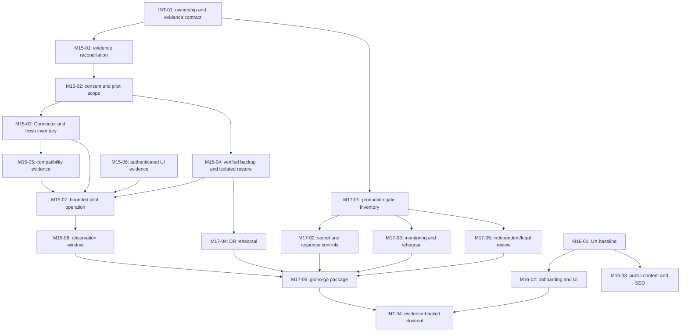

# WP CareGrid — Master Roadmap & Parallel Integration Plan

**Planning baseline:** 2026-10-24  
**Repository:** `zsoltacsai/wpcaregrid`  
**Authoritative branch:** `claude/ecstatic-wozniak-oemyuf`  
**Verified source baseline:** `5e2ae13bade94251b7a38bd9a940bc29fbe639fd`  
**Baseline CI:** run [40125296872](https://github.com/zsoltacsai/wpcaregrid/actions/runs/40125296872), exact SHA, 37/37 jobs successful  
**Status:** planning proposal; it does not authorize implementation, a staging operation, production change, or launch.

## 1. Purpose and planning rules

This document reconciles the current M14 closeout with the proposed M15–M17 work and provides four independently scoped execution prompts. M14 is closed within its documented scope. M15 carries operational pilot-readiness items forward; M16 is a proposed customer-facing product and web experience stream; M17 prepares production readiness. The labels are a planning taxonomy, not evidence that those milestones have already been approved or completed. Their acceptance criteria require owner review before implementation starts.

Keep the established security boundaries:

- Owner and Operator functions remain server-authorized; tenant isolation and subscription enforcement are not replaced by UI checks.
- No generic scanner override, arbitrary remote execution, or synthetic-fixture identity reuse.
- A verified backup is required before an operation that can change a site. Restore rehearsal stays on an isolated staging copy.
- Never enable automatic remediation for a pilot by implication.
- Unknown, stale, or unsupported compatibility evidence remains fail-closed for high-risk operations.
- No production deployment, live payment, credential creation, customer-data operation, DNS change, or server configuration change is authorized by this plan.
- Do not remove historical reports. Update the current status record only through the integration owner after evidence is available.

## 2. Baseline and current evidence

### Completed

- **M14 — CLOSED — VERIFIED, bounded scope.** PR #171 merge SHA `b152fcfc53543938c27d820d966ca99bd56e22d6`; exact merge CI run 40108236754 passed 30/30. The documented Integrity scan on `kiszov-szeged.hu` completed as `COMPLETED`: 5,930 verified, 0 modified/extra, 1 missing, 4 unavailable, 0 findings. This was an Integrity scan, not malware/full coverage or a clean-bill-of-health certification.
- M14 evidence records the scan UUID `01a16dfa-afed-735f-a4fd-2eafcd0a8a3d`. Coverage was incomplete and notification delta was unknown. Do not upgrade those facts by inference.
- PR #165 (PHPUnit 13.4.3) and #166 (Alpine.js 3.17.5) are recorded as merged; exact merge CI runs 40117322988 and 40119815251 passed 30/30. Staging deployment was reported for those dependencies, but the corresponding release receipt was not archived in the status document.
- PR #172 reconciled the M14 status documentation and merged as `5e2ae13bade94251b7a38bd9a940bc29fbe639fd`. Its exact-SHA CI run 40125296872 has 37 successful jobs, including the live Connector PHP/WordPress/database matrix, Server MariaDB/MySQL/SQLite jobs and in-WordPress Connector jobs.
- Current source CI is broader than the older “7 jobs” or “30 jobs” references. At the planning baseline, the run reports 37 successful jobs. Before every future PR, inspect the live workflow and the exact run's full job set; never use a historical job count as a gate.
- An active GitHub ruleset named **Authoritative primary release controls** was visible at planning time. Before a merge, confirm which contexts are required and enforced for the current candidate; do not infer enforcement solely from the ruleset name.

### M15 carry-forward facts

The current status and release documents carry these items, each requiring fresh, environment-labelled evidence before closure:

1. One Connector was reported offline. Resolve its target, owner consent and actual state before any operational action; do not treat repeated polling as harmless.
2. A verified backup was not current within the documented seven-day window. Verify source, age, integrity and restoration evidence before any site-changing pilot step.
3. The M14 Integrity scan had incomplete coverage (one missing and four unavailable files); no malware/full scan is implied.
4. Authenticated Operator UI visual verification was not completed after the browser session expired.
5. Compatibility evidence for the actual pilot hosting environment needs a current, operation-specific result.
6. Monitoring/observation and notification evidence needs a defined period and named owner.
7. Recovery and restore assurance remains distinct from backup creation or a successful scanner result.

### M17 carry-forward facts

M17 is production-readiness preparation, not production launch approval. Independent security testing, production security verification, disaster-recovery assurance, legal/accounting decisions, live-payment readiness and explicit release authorization remain external or separate gates. Staging CI does not close them.

### Documentation reconciliation rule

`docs/PROJECT_STATUS.md` is the current status source; `docs/RELEASE_CHECKLIST.md` contains environment/configuration items some of which predate recent staging work. The first implementation task in each operational stream is a timestamped evidence reconciliation: label each claim as verified, stale, unknown, or not configured and name its environment. Do not silently mark an old checklist row complete or rewrite historical incident reports.

## 3. Proposed milestone structure

| Milestone | Purpose | Exit evidence | Explicit non-goal |
|---|---|---|---|
| **M15 — Controlled pilot & operational readiness** | Close bounded staging/pilot gaps using consented non-production sites; validate safe connector, backup, update, scan and monitoring flows. | Current site consent/scope; fresh pairing/inventory/compatibility; verified backup and isolated restore evidence; operation-specific compatibility; authorized functional checks; bounded observation and reviewed closeout. | Batch testing, customer-data changes without per-action consent, broad production operation, or interpreting one Integrity scan as malware coverage. |
| **M16 — Product experience & acquisition readiness (proposed)** | Improve Owner, Operator and Customer UX, accessibility, onboarding and evidence-based public web content. | Approved UX scope; tested responsive/accessibility behavior; content claims tied to evidence; reviewed analytics/SEO and conversion measures. | Changing authorization, billing, privacy, scanner decisions or security policy for visual convenience. |
| **M17 — Production-readiness preparation** | Build the evidence and controls needed for a later launch decision. | Production configuration inventory; monitoring/alert runbooks; backup/DR rehearsal; independent review findings and disposition; legal/accounting decision register; signed go/no-go package. | Production deployment, live customer/payment operations, declaring launch-ready before independent and Owner gates. |

These proposed labels organize work; the Owner or project governance must approve their acceptance matrices before work is treated as a committed milestone.

## 4. Workstream ownership and boundaries

| Thread | Owns | May coordinate on | Must not do |
|---|---|---|---|
| **1 — M15** | Pilot readiness evidence, Connector lifecycle, compatibility, backup/restore proof, non-destructive pilot procedures and monitoring. | Scan/backup service contracts with Thread 4; Operator UI verification with Thread 2. | Production operations, bulk scans, unconsented customer changes, restore on a live site, or altering shared security defaults. |
| **2 — M16** | Customer-facing UX, accessibility, onboarding, public content and technical SEO. | Shared layout tokens and visual review with Thread 4; Operator screen ownership with Thread 1. | Changes to authorization, subscription, tenant isolation, scanner/backup policy, payment behavior or security copy without domain-owner approval. |
| **3 — M17** | Production-readiness evidence, threat/ops review, monitoring, incident response, backup/DR and launch decision inputs. | Read-only architecture/release evidence with Threads 1 and 4. | Production deploy/configuration, live credentials/payments or destructive recovery without a distinct explicit procedure and approval. |
| **4 — Integration & QA** | Shared contracts, collision arbitration, CI evidence, PR ordering, documentation status register, merge/deployment coordination. | All three implementation threads. | Taking over another stream's implementation, weakening CI, merging without applicable review/checks, or serializing staging changes without the approved controller. |

## 5. Prioritized backlog

Estimates are engineering effort, excluding review/queue delays. Confidence is the planning confidence for scope, not a delivery promise. “Deploy” means a protected staging release only if runtime code or assets change; no production deployment is implied.

| ID | Thread | Goal and deliverable | Likely source areas | Dependencies | Priority / estimate / confidence | Validation and acceptance | Deploy | Impact / concurrency |
|---|---|---|---|---|---|---|---|---|
| **M15-01** | 1 + 4 | Reconcile status/checklist into a dated pilot evidence register, including offline Connector, backup age, incomplete Integrity coverage, UI, host compatibility and monitoring. | `docs/PROJECT_STATUS.md`, `docs/RELEASE_CHECKLIST.md`, `docs/PILOT.md` | None | P0; 1–2 d; high | Each claim has evidence date, environment, owner and state; stale/unknown remain open. | No | Honest release evidence; **shared docs collision**, Thread 4 is sole status-file editor. |
| **M15-02** | 1 | Define per-site pilot authorization, scope, consent evidence, stop conditions and site inventory; do not create a synthetic/customer identity substitute. | Pilot docs, Owner/Operator workflows, policy/config as evidence indicates | M15-01; Owner site consent | P0; 1–3 d; medium | Exact website/connector/operation and consent recorded; deny unapproved sites and operations; no duplicate registration. | Maybe | Customer trust and tenant isolation; touches policy and routes, coordinate with Thread 4. |
| **M15-03** | 1 | Repair or explain offline Connector and verify authenticated heartbeat, bounded poll, lease, outbox, result ingestion and fresh inventory. | Connector API, polling/jobs, inventory and capability snapshot | M15-02; approved target | P0; 2–5 d; medium | One pending job at a time; exact connector match; persisted current inventory and operation-specific readiness; replay/tenant negatives pass. | Yes if runtime change | Polling and scan safety; **high collision** with `app/Security`, queue and Connector modules. |
| **M15-04** | 1 | Establish backup freshness, integrity, destination, retention and isolated restore rehearsal evidence. | Backup services/jobs, storage config, runbooks | M15-02; isolated copy and approved storage | P0; 2–5 d plus external restore window; medium | Backup verified by manifest/checksum; restoration rehearsal on isolated copy; no live restore; failures remain non-verified. | Maybe | Highest data-loss impact; coordinate storage and queue paths with Thread 3/4. |
| **M15-05** | 1 | Complete operation-specific Connector compatibility matrix for PHP 8.2–8.5 and representative WordPress/MySQL/MariaDB versions; keep Laravel runtime requirements separate. | Connector compatibility policy, CI matrix, tests/docs | M15-03; current supported-version policy | P1; 3–6 d; medium | Each runtime/operation has passing fixtures before “tested”; unknown stays blocked for high-risk actions; full current CI incl. MySQL concurrency. | Yes if code changes | Broad customer compatibility; CI workflow and lockfile conflicts are **serialized**. |
| **M15-06** | 1 | Verify authenticated Owner/Operator pilot screens and accessible workflows; capture sanitized evidence. | Operator/Owner views, browser tests | M15-01; active authorized session | P1; 1–3 d; high | Correct role-specific view, no cross-tenant leakage, actions and status agree with server, accessibility smoke passes. | Yes if UI changes | M16 overlap on UI; split Operator functional evidence (1) from visual redesign (2). |
| **M15-07** | 1 | If separately approved, run one bounded non-destructive pilot operation on a consented non-production site after backup and readiness gates. | Existing normal scan/update workflow and audit | M15-02/03/04/05; operation-specific GO | P1; 1–3 d plus observation; medium | No mutation beyond explicit operation; exact jobs/results/coverage/audit and side-effect deltas; stop conditions honored. | Usually yes | No automatic remediation; do not repeat scan simply to improve status. |
| **M15-08** | 1 + 3 | Observe pilot health, queue, backup, alert and support signals over an agreed period; record issues and rollback. | Monitoring integration and ops runbooks | M15-07; monitoring source | P1; 5–10 elapsed business days; low/medium | Named reviewer, signal thresholds, incident escalation, no silent gaps; Owner accepts residual issues. | No or protected config release | External time dependency; do not claim observation complete early. |
| **M16-01** | 2 | Baseline responsive, accessibility, usability and localization for Owner, Operator and Customer experiences; produce scoped design backlog. | `resources/views`, CSS/JS, browser tests | Approved M16 scope | P1; 2–4 d; high | Keyboard, focus, labels, contrast, responsive and role navigation baseline captured. | No | UI overlaps M15 Operator screen; Thread 2 owns design system, Thread 1 owns pilot correctness. |
| **M16-02** | 2 | Improve onboarding, forms, empty/error/loading states and navigation without changing server-side permissions. | Views/components, frontend assets | M16-01 | P1; 4–8 d; medium | Component/browser tests; route policy unchanged; no secret or customer-data leakage; screen-reader-friendly errors. | Yes | Changes shared layouts/CSS; coordinate component fence before edits. |
| **M16-03** | 2 | Review public content, SEO metadata, performance and conversion instrumentation; create evidence-based content changes. | Public pages, metadata, build assets | M16-01; approved claims/analytics | P2; 2–5 d; medium | Claims linked to verified product capability; no fake metrics/certification; performance baseline and privacy-safe analytics. | Yes | Avoid claims beyond M14 evidence; public layout can conflict with M17 legal review. |
| **M17-01** | 3 | Reconcile release checklist into staging vs production control inventory and identify independent approvals. | `docs/RELEASE_CHECKLIST.md`, deployment docs | M15-01; read-only environment evidence | P0; 2–4 d; medium | Every gate has owner, evidence and status; unknown is not pass; no production changes. | No | Shared release docs; Thread 4 merges evidence. |
| **M17-02** | 3 | Define production secret inventory, access review, rotation and incident response evidence without creating credentials. | Deployment/config docs, secret access controls, incident runbooks | M17-01 | P1; 3–6 d; medium | Least-privilege matrix, audit, break-glass and rotation process reviewed; no secret values in repo. | No | Security critical; no secret creation/access mutation. |
| **M17-03** | 3 | Establish monitoring/alert coverage and on-call/incident response rehearsals. | Monitoring, queue/scheduler, operations docs | M17-01; M15-08 signals | P1; 3–6 d plus rehearsal | Alert delivery, actionable thresholds, owner and response evidence; no false “configured” status. | Maybe, protected staging only | Possible infrastructure dependencies; keep service accounts least privilege. |
| **M17-04** | 3 | Define backup/DR objectives and conduct isolated restore/tabletop rehearsal. | Backup storage, deployment/DR docs | M15-04; approved isolated environment | P1; 4–8 d plus recovery window | RPO/RTO evidence, integrity check, restore acceptance and cleanup; never restore production data to public staging. | Isolated only | Data protection and retention; storage changes need separate approval. |
| **M17-05** | 3 | Prepare independent security review and legal/accounting decision register; track findings to disposition. | Security architecture, privacy/billing docs | M17-01; external reviewers/advisors | P1; 3–6 d plus external queue | Scope, evidence access, finding owner/severity/SLA; no certification claim before report. | No | External dependency, can run in parallel with M15/M16. |
| **M17-06** | 3 + 4 | Compile production go/no-go package after all evidence and Owner approvals. | Status/checklist and evidence links | M15 acceptance; M16 approved claims; M17-02/03/04/05 | P0 final; 1–3 d; medium | Explicit unresolved risks and approvals; no launch implied by CI or staging; owner signs final gate. | No | Final integration-only action; no deploy authority. |
| **INT-01** | 4 | Establish shared PR contract, branch/worktree inventory, ownership map and evidence index. | `docs/MASTER_ROADMAP_AND_INTEGRATION_PLAN.md`, PR conventions | This planning proposal | P0; 1 d; high | All threads acknowledge file fences, base SHA and reporting template. | No | Sole integration owner for master plan. |
| **INT-02** | 4 | Keep live CI/ruleset inventory current and verify exact candidate and merge-SHA checks. | `.github/workflows/ci.yml`, GitHub ruleset | Each PR | P0; 0.5–1 d per integration; high | No required job skipped; MySQL process-concurrency gate passes; exact SHA/run linked. | No | Workflow edits only by explicit coordination; never weaken mandatory gates. |
| **INT-03** | 4 | Serialize protected staging releases and capture receipts/health evidence. | Deployment controller/runbook and release receipt | Runtime PR CI; no active deployment | P0; 0.5–1 d per release; medium | Controller, exact SHA, pre/post checks, receipt; no manual copy. | Yes through controller | One staging mutation at a time. |
| **INT-04** | 4 | Integrate milestone acceptance and publish closeout only from verifiable evidence. | `docs/PROJECT_STATUS.md`, evidence docs | All owned tasks | P0; 1–2 d per closeout; high | Exact claims, scope limits and remaining obligations independently checked. | No | Thread 4 sole editor of shared status file. |

## 6. Dependency graph and critical path



**Critical path:** evidence reconciliation → explicit target/consent/scope → authenticated Connector and fresh inventory/readiness → verified backup + isolated restore proof → operation-specific compatibility → approved bounded operation (if accepted) → agreed observation period → production-readiness evidence and Owner go/no-go. Independent review, legal/accounting, storage and monitoring delivery can dominate elapsed time. M16 can proceed in parallel after UI ownership and content-claim boundaries are agreed.

## 7. Worktree, branch and file-collision architecture

The current shared local checkout is dirty and stale. **Never reset, clean, checkout over, or commit from that checkout.** Use a fresh isolated worktree per implementation thread, rooted at a confirmed latest authoritative SHA. Example branches and sibling paths:

| Thread | Branch | Isolated path example |
|---|---|---|
| 1 | `codex/m15-pilot-readiness` | `../wpcaregrid-m15-pilot` |
| 2 | `codex/m16-frontend-ux` | `../wpcaregrid-m16-ux` |
| 3 | `codex/m17-production-readiness` | `../wpcaregrid-m17-readiness` |
| 4 | `codex/integration-qa` | `../wpcaregrid-integration-qa` |

Rules: worktrees are independent; no shared working directory. Recheck primary SHA before branch creation. No force pushes. Each thread opens a focused PR to the authoritative branch. Thread 4 tracks overlap and integration but does not push implementation commits on another thread’s behalf. Keep one protected merge path; rebase/update only through supported mechanisms.

### Collision matrix

| Shared surface | Primary owner | Coordination rule |
|---|---|---|
| `docs/PROJECT_STATUS.md` and master evidence index | Thread 4 | Sole writer. Other threads submit proposed evidence blocks with source links; Thread 4 reconciles after verification. |
| `docs/RELEASE_CHECKLIST.md`, `docs/DEPLOYMENT.md`, `docs/PILOT.md` | Thread 4 integrates; Thread 1/3 propose scoped sections | Do not edit same file concurrently; agree section/file ownership before branch work. |
| `routes/web.php`, middleware and authorization policies | Thread 1 for pilot behavior; Thread 3 read-only review | Any authorization edit is high-risk; one PR owner, explicit negative tests and independent review. |
| `app/Security`, `app/Backups`, queues and Connector API | Thread 1 | Thread 3 may review architecture but must not patch concurrently. |
| `resources/views/components/layouts`, CSS/JS shared tokens | Thread 2 | Thread 1 supplies pilot correctness requirements; no concurrent view redesign. |
| Billing, tenant and subscription models | No stream owns broad changes | Thread 4 stops and re-scopes; do not bundle with unrelated work. |
| Migrations, models and shared enums | Thread 4 assigns one PR owner | No concurrent schema edits. Additive/backward-compatible rationale and rollback plan required. |
| `.github/workflows/ci.yml` | Thread 4 assigns a single owner after review | Matrix expansion only; never remove coverage or mandatory checks. |
| `composer.lock`, `wordpress/composer.lock`, `package-lock.json` | Change-owning thread, sequential updates | Avoid simultaneous dependency/build changes; review exact lockfile diff. |
| `config/*`, global runtime defaults | Thread 1 or 3 only by domain; Thread 4 arbitrates | Global defaults are high risk; prefer operation-specific, scoped policy and tests. |

## 8. CI and integration protocol

The authoritative baseline run had 37 successful jobs. This is a snapshot, not a permanent count. At PR time inspect `.github/workflows/ci.yml`, the active ruleset, required checks, skipped jobs and exact run SHA. The current matrix includes PHP 8.2–8.5 Connector combinations, WordPress 6.8/7.1, MySQL 5.7/8.0/current labels, MariaDB, SQLite and server jobs. Preserve the mandatory MySQL process-concurrency job.

For each PR, Thread 4 follows this sequence:

1. Confirm owner, scope, source SHA and clean isolated branch.
2. Check existing PRs and active workstreams for file or staging overlap.
3. Agree interfaces and file fences before parallel edits.
4. Run focused tests and static checks in the owning worktree.
5. Review full diff, migrations, security/tenant boundaries and rollback path.
6. Open a focused PR; list exact source SHA and test results.
7. Require fresh CI on the PR head; inspect every mandatory job and actual head SHA.
8. Obtain independent review for authorization, billing, backup, scanner, storage or secret-control changes.
9. Merge only via protected supported workflow after current requirements pass.
10. Verify primary branch points to the merge SHA and rerun/verify exact merge-SHA CI, including MySQL concurrency.
11. For runtime changes, serialize protected staging deployment through the approved controller and archive receipt; test health and relevant roles.
12. Update status/evidence only after checking the receipts, then close the thread with completed/open/blocked items.

Resource strategy: run focused tests early; avoid launching multiple full matrices for the same candidate; do not cancel other workflows or lower matrix fanout. Merge dependencies sequentially when shared lockfiles or contracts overlap. A skipped, queued or running mandatory job is not a pass. A transient runner failure may be rerun through GitHub; distinguish infrastructure from a reproducible product failure.

## 9. Immediate readiness observations and risk register

| Risk / blocker | Evidence at baseline | Owner | Mitigation / exit condition |
|---|---|---|---|
| Connector offline | M15 carry-forward from current status; target requires fresh reconfirmation. | Thread 1 | Identify exact site and consent; one bounded diagnosis; authenticated heartbeat and result ingestion before work. |
| Backup freshness/integrity | Current status says no verified backup within the documented seven-day window. | Thread 1 + 3 | Verify exact backup provenance/age/integrity; isolated restore rehearsal; no update/restore until verified. |
| Integrity coverage incomplete | M14 scan found 1 missing and 4 unavailable; coverage expressly incomplete. | Thread 1 | Explain unavailable paths, do not relabel as clean; obtain only an authorized follow-up on a safe target. |
| Operator UI verification incomplete | Active authenticated visual verification not completed after session expiration. | Thread 1 + 2 | Owner-authorized browser review; separate functional correctness from visual/accessibility work. |
| Compatibility evidence | Actual hosting operation support requires current evidence. | Thread 1 | Use operation-specific matrix; PHP Connector runtime separate from Laravel server runtime; unknown fails closed for high-risk operations. |
| Notification delta unknown | Historical M14 closeout notes unknown delta. | Thread 1 + 4 | Determine available audit evidence without exposing customer data; mark unknown if irrecoverable. Do not infer zero. |
| Production readiness incomplete | Independent review, production security verification, DR and legal/accounting decisions remain open. | Thread 3 | Build evidence and external action register; no production launch claim. |
| Release checklist drift | Current checklist includes older NOT CONFIGURED entries that may differ from staging reality. | Thread 3 + 4 | Timestamped environment-by-environment reconciliation; preserve old status where current proof absent. |
| UI work collision | M15 Operator proof and M16 UI redesign touch shared layouts/screens. | Thread 4 | Freeze component/file ownership; M15 tests behavior and records gaps; M16 changes presentation in separate components. |
| CI policy uncertainty | Active release ruleset is visible; exact enforced contexts should be confirmed for each PR. | Thread 4 | Read live ruleset/branch protection; if mandatory checks are not enforced, do not treat an informal green run as equivalent protected merge. |
| Shared checkout contamination | Local checkout was dirty and behind at planning time. | All | Isolated worktrees only; preserve all existing untracked/modified files. |

## 10. Recommended sequence and acceptance

1. Thread 4 publishes the contract, confirms current branch/ruleset/worktree state and assigns file fences.
2. Start Threads 1 and 3 in parallel on read-only evidence and independent design tasks. Thread 2 may begin a UX baseline that avoids files reserved by Thread 1.
3. Thread 1 completes consent and safe operational prerequisites before any site operation; Thread 3 prepares production controls without live configuration changes.
4. Thread 2 implements scoped UI/content improvements after Thread 4 resolves shared layout ownership.
5. Integrate each focused PR with exact-head CI, review and merge-SHA CI. Serialize staging deployments; do not deploy plans or docs unnecessarily.
6. Complete M15 observation period and M17 independent/external evidence before final go/no-go.
7. Thread 4 reconciles the acceptance matrices and prepares an Owner decision. “Ready” is not “launched”; production remains blocked until a separate explicit launch decision.

A milestone may close only when each accepted criterion is linked to dated evidence and unresolved items are either fixed or explicitly accepted by the proper Owner. CI alone, a green dashboard badge, one scan, or an unverified backup never closes the operational gates.

## 11. Cross-thread status report template

```text
THREAD:
Branch / worktree:
Starting primary SHA:
Current PR / candidate SHA:
Owned scope:
Files changed:
Focused checks:
Full CI run + exact head SHA:
Required MySQL concurrency result:
Review / merge status:
Staging action (none / controller receipt / exact deployed SHA):
Evidence links:
Security and commercial impact:
Open risks / external dependencies:
Next action:
```

## 12. Ready-to-use execution prompts

### Thread 1

[THREAD 1/4 — M15]

You own WP CareGrid M15 controlled pilot and operational readiness. Start by refreshing the authoritative branch and recording the exact SHA. Use a clean dedicated worktree on `codex/m15-pilot-readiness`; never edit or clean the shared dirty checkout.

Scope: reconcile Connector availability, pilot site consent/scope, authenticated polling/result ingestion, fresh inventory and operation-specific compatibility; verify backup provenance and freshness, plan restore rehearsal only on an isolated copy, review incomplete Integrity coverage, and perform authenticated Operator functional verification. Build a dated evidence register and a bounded pilot procedure. Do not scan, update, restore, or change a website until exact target, owner consent, backup, compatibility and operation-specific authorization are verified.

Owned areas: Connector/polling/inventory/security/backup services and tests, plus proposed sections in `docs/PILOT.md`. Coordinate all shared status/checklist changes with Thread 4. Thread 2 owns visual redesign; you own pilot workflow correctness. Do not alter billing, global security defaults, synthetic identity, M8/M14 fixture semantics or production configuration.

Dependencies: obtain Thread 4 file fences first. Unknown or stale evidence stays open. Preserve privacy and tenant isolation; use one pending job at a time and no duplicate requests. No customer-facing operation without per-operation authorization.

Validation: focused tests, negative auth/tenant tests, exact CI head with every currently required job and MySQL concurrency gate. Open focused PRs to the authoritative branch; do not force-push or merge around branch protection. Deploy runtime changes only through the protected staging controller after fresh merge-SHA CI and coordination with Thread 4. No production deploy.

Report using the cross-thread template. Distinguish verified, stale, unknown and not configured; do not claim full malware coverage from an Integrity scan.

### Thread 2

[THREAD 2/4 — M16]

You own the proposed M16 frontend, accessibility, onboarding and evidence-based acquisition experience. First obtain Thread 4’s file fences and refresh the authoritative SHA. Use an isolated worktree on `codex/m16-frontend-ux`; do not touch the shared dirty checkout.

Begin with a visual, keyboard/accessibility, responsive, localization and usability baseline for Owner, Operator and Customer roles. Then implement only approved, scoped UX changes: onboarding, navigation, forms and clear loading/empty/error states; assess public metadata, performance and privacy-safe analytics. Keep product claims tied to verified evidence and never add fabricated metrics, certifications or security assurances.

Owned areas: view/components, CSS/JS design tokens, public pages, and corresponding browser/accessibility tests. Coordinate shared layouts with Thread 1 and Thread 4 before edits. Do not change backend authorization, tenant isolation, billing, subscription entitlement, scanner, backup, payment/webhook or privacy behavior. Do not change shared status/checklist docs; submit evidence to Thread 4.

Run focused frontend/browser tests, then fresh full required CI for the exact PR head, including MySQL concurrency even when UI files are the only changes. Open a focused PR. No force-push, skipped gates, direct primary commits or unauthorized staging changes. If runtime assets change, wait for merge-SHA CI and Thread 4’s release slot before protected staging deployment; no production deployment.

Report screenshots/test evidence and residual accessibility/UX gaps with the cross-thread template.

### Thread 3

[THREAD 3/4 — M17]

You own M17 production-readiness preparation, not production launch. Refresh the primary SHA and use a clean isolated worktree on `codex/m17-production-readiness`. Never modify the shared dirty checkout.

Reconcile staging and production release gates using dated evidence. Prepare least-privilege secret access/rotation procedures without creating, copying or exposing credentials; monitoring and incident response requirements; backup/DR objectives; isolated restore/tabletop rehearsal plans; independent security review scope and finding register; and legal/accounting decision dependencies. Clearly separate controls that are merely documented from controls proven operationally.

Owned areas: production-readiness and incident/DR documentation, architecture risk register and tests for documentation/config contracts only if approved. Coordinate `docs/RELEASE_CHECKLIST.md` edits with Thread 4; do not edit `docs/PROJECT_STATUS.md` directly. Do not change runtime production configuration, create credentials, perform live payments, deploy production, restore live data, or weaken security. Staging configuration changes require a separate approved procedure and release slot.

Dependencies: Thread 4 defines file fences; Thread 1 supplies pilot backup/monitoring evidence. External reviewer and legal/accounting decisions remain explicit dependencies, not assumptions.

Validate documentation links, policy consistency and any focused checks; all code changes require current full CI and the MySQL concurrency gate. Use focused PRs, protected merge and exact-SHA evidence. Do not label production READY or M17 closed until independent review, DR proof and Owner go/no-go are recorded.

Report completed evidence, external owners/dates, decisions needed and open risks with the cross-thread template.

### Thread 4

[THREAD 4/4 — INTEGRATION & QA]

You are the integration and quality coordinator for the M15–M17 streams. Begin by refreshing the authoritative branch, confirming the current ruleset/required check contexts, checking worktree/PR/deployment activity and publishing the file-collision fences. Never modify or clean the shared dirty checkout; use a dedicated integration worktree only for documentation/evidence integration.

You own `docs/PROJECT_STATUS.md`, the master evidence index and PR/deployment sequencing. You do not implement another stream’s feature. Keep M15/M16/M17 explicitly proposed until their acceptance matrices are Owner-approved. Resolve overlapping files and schema/API contracts before concurrent edits; serialize migrations, CI workflow changes, lockfiles and staging deployments.

For every PR, verify narrow scope, current base, complete diff, review, required CI on exact head, no skipped mandatory checks, and MySQL process-concurrency result. Merge only through the current protected workflow; then verify the exact merge SHA and its CI. Stage runtime changes only through the approved controller, one deployment at a time, and archive the receipt. Do not deploy docs-only work unnecessarily. Never deploy production or change secrets/payment/customer data under this plan.

Reconcile status only from actual receipts. Preserve historic evidence and caveats; unknown is not zero, stale is not fresh, UI READY is not backend authorization, and CI green is not operational readiness. At each closeout, identify remaining independent review, owner, legal, recovery or observation obligations.

Use the cross-thread report template; give each stream concise integration feedback and keep a resumable evidence ledger.
