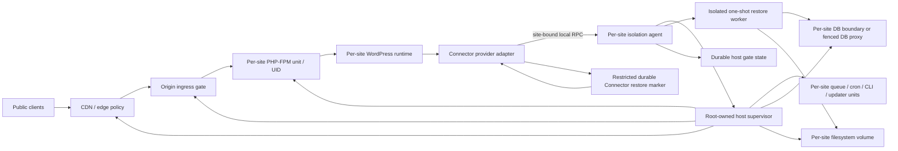

# ADR M15-01 — Per-site host agent and isolated runtime for restore isolation

- **Status:** Proposed; awaiting explicit Owner architecture approval
- **Date:** 2026-10-25
- **Decision scope:** Host isolation architecture only. This ADR does not authorize provider implementation, provider allowlisting, deployment, or a live restore.
- **Baseline:** `claude/ecstatic-wozniak-oemyuf` at `de54ed273478ec6739cf27a40c8eda27697f0974`
- **Related decision record:** [M15 restore isolation gate contract](../reports/m15-restore-isolation-gate-contract.md)
- **Tracking:** [Issue #189](https://github.com/zsoltacsai/wpcaregrid/issues/189)

## 1. Context

PR #182 introduced a fail-closed Connector/platform contract for destructive restore. The Connector asks a `RestoreIsolationGateProvider` to acquire, assert, commit, and release an opaque lease. Platform readiness accepts a provider identity only from a fresh Connector capability snapshot and an explicit server-side allowlist. That identity is a readiness fact: it is not evidence that a host gate is currently held. The Connector must acquire and reassert a real gate before live database or filesystem mutation.

A PHP `.maintenance` file, ownership token, or Connector `flock()` cannot exclude WordPress code, another PHP process, a queue worker, a cron/CLI process, a deployment tool, or a direct database client that does not cooperate with the Connector. A path check followed by `unlink()` or replacement is also subject to filesystem races. The provider must therefore control the host-level writer and ingress boundaries, not infer exclusivity from Connector process state.

The current provider interface and platform allowlist intentionally have no production implementation or supported host configured. Unsupported or uncertain environments must continue to refuse live restore before mutation. This ADR describes a candidate design for one explicitly bounded hosting profile. It does not assert that any existing staging or production host has that topology.

## 2. Decision proposed

Adopt a **per-site host isolation agent controlling a dedicated site runtime** as the first provider architecture to implement and evaluate.

The supported profile requires a site-specific runtime boundary for ingress, PHP-FPM, storage, database access, schedulers, queues, CLI, updates, and deployment. A privileged host supervisor may exist, but the Connector-facing provider is a per-site logical agent with a fixed site binding and a narrow RPC surface. It is not a root shell, a general command runner, or a customer-configurable control plane.

The first implementation must support only hosts whose exact configuration demonstrates all required boundaries. A missing/unknown writer, origin/CDN route, service, or database/file path makes acquisition fail closed. “Dedicated VPS” by itself is not sufficient evidence.

### 2.1 Target topology

The host agent maps its local socket and process identity to a site identifier from root-owned configuration. The caller cannot supply arbitrary unit names, paths, hosts, SQL, shell fragments, or control actions. A root-owned supervisor performs a fixed set of typed operations; the agent is confined to one site’s configured units, ingress policy, database boundary, and volume. Per-site processes, cgroups, UIDs, mount namespaces, and service identities must not be shared with another site.

A compromised site process must not gain a general host-control primitive. Local peer credentials establish which site runtime is calling; they do **not**, by themselves, prove that the requested restore was authorized. Before implementation, the Owner must approve how a short-lived, replay-resistant restore authorization is bound to site, restore UUID, scope, backup identity, job/lease identity, audience, and expiry. The current provider method signatures do not carry such an authorization object. This is a contract gap to resolve explicitly; do not treat socket permissions as a substitute for platform authorization.

### 2.2 Ingress, CDN, origin, and in-flight request closure

Acquisition begins by durably recording a closed/acquiring state. The agent then closes the **origin first** for the site: the origin must reject public requests and direct-origin access, while retaining only the narrowly authenticated management/control path needed for reconciliation. It next applies a site-specific edge deny and cache-bypass/purge policy. CDN policy success must be acknowledged by the provider integration; cached responses, alternate hostnames, IPv4/IPv6 listeners, alternate ports, load balancers, and direct origin routes must be included in the compatibility evidence.

The gate may not report acquired while any public path can serve the site or reach a mutating handler. If the CDN has no enforceable per-site policy or the origin is publicly reachable around it, the host is unsupported. A firewall change that affects a shared listener or another tenant is prohibited.

After new requests are rejected, the agent drains in-flight requests and persistent connections for the site. It must observe that the site PHP-FPM pool and all request workers have no in-flight state-changing request before stopping/fencing them. Drain is bounded. A timeout, incomplete counter, control-plane error, or unrecognized connection leaves the site closed and returns failure; it does not silently continue. Do not use a shared PHP-FPM master shutdown as a shortcut.

A read-only, local health/control route may remain available only if it is outside the public application runtime, has a separate identity, cannot write site state, and cannot expose secrets. Its exemption must be demonstrated, not assumed.

### 2.3 Writer inventory and fencing

The implementation must maintain an explicit per-site inventory and control proof for every writer class. New or unknown writers invalidate the profile until reviewed.

| Writer class | Required boundary while gate is held |
|---|---|
| HTTP / PHP-FPM / WordPress admin and REST | Origin and edge deny new traffic; drain and fence the dedicated site pool. No shared pool. |
| WP-Cron and external cron | Disable/fence the site’s internal cron trigger and every host, panel, or external scheduler entry. Drain any current run. Unknown external cron is NO-GO. |
| Action Scheduler and application queues | Pause producers and site-specific workers; wait for active jobs to finish or prove they are fenced before apply. Do not clear or discard queued work. A retry cannot run until the gate is released. |
| WP-CLI and maintenance scripts | Run only through a site-scoped launcher that checks the host gate. Fence interactive/automated CLI and maintenance commands during apply. Unknown shell or panel access is a compatibility blocker. |
| Core/plugin/theme updates | Disable/fence in-application and host/vendor update mechanisms, including scheduled updates and filesystem replacement. |
| Deployment and release automation | Deployment controller must acquire the same host gate or fail before changing code, schema, assets, workers, or configuration. Deploy while restore is active is denied. |
| Direct database clients | Prefer a per-site DB instance. Otherwise all site writes must pass through a site-aware proxy enforcing the active generation; direct network access and shared/untracked credentials must be blocked. Drain existing write sessions. Shared database global read-only mode is not acceptable. |
| Filesystem writers | Site files/volume must have a unique site identity. Fence all site writers and expose a writable mount only to the one-shot restore worker while applying. Other sites, backup/sync tools, antivirus hooks, root-owned scheduled jobs, and deployment agents must be inventoried and controlled. |
| Human/provider operations | Only the separately approved, audited break-glass recovery path may operate while closed. Untracked provider-console actions or root processes capable of writing the site make the claim conditional/unsupported. |

The initial supported profile should require a **dedicated per-site database instance and filesystem volume** where available. A shared database may be considered only after a site-aware write proxy, direct-connection denial, session drain, and adversarial evidence are demonstrated. Per-schema grants alone do not fence already-open sessions or other holders of the same credential.

A unique Unix UID and mount boundary are necessary but not sufficient if a process with broader host privilege can write around them. The host threat model trusts the provider’s host kernel/root control plane; it does not claim protection against a malicious or compromised host root. The provider must nevertheless make routine application, deployment, scheduler, and customer processes unable to bypass the site gate.

### 2.4 Provider RPC and privilege boundary

The Connector adapter uses a local, site-specific Unix-domain socket with strict filesystem permissions. The agent verifies peer credentials and a root-owned UID-to-site mapping on every request. RPC messages are typed, size-bounded, versioned, and reject unknown fields/actions. The protocol exposes only the contract operations: stable provider identity, acquire/resume, assert, two-phase commit, and exact-generation release. It returns bounded success/failure codes and opaque lease data only where the Connector contract requires it.

The agent never accepts arbitrary commands, executable names, environment variables, destination paths, URLs, SQL, unit names, or caller-selected site IDs. It uses fixed root-owned configuration. It rate-limits and serializes per-site requests. Inputs are validated against the platform-signed authorization decision once an approved authorization mechanism is selected. Retries are idempotent; replayed or expired authorization cannot create a new restore generation.

The privilege implementation must be reviewed separately. If operations require a root-owned broker, its API and service policy must be smaller than the set of host capabilities exposed to the Connector. The WordPress/PHP process must never inherit the broker’s credentials or control socket access for another site.

## 3. Durable generation state machine

The host agent’s state is authoritative for host enforcement; the Connector’s restricted restore marker is authoritative for Connector recovery linkage. Both must be reconciled. No lease timeout or process-local `active` variable may reopen the site.

### 3.1 States

- **OPEN** — ordinary site runtime is enabled.
- **ACQUIRING(g)** — a new generation is durably reserved; ingress/writer closure is in progress.
- **DRAINING(g)** — new ingress is denied and in-flight requests/jobs/sessions are draining.
- **QUIESCENT(g)** — all writer and bypass checks have affirmative evidence; only now may the provider return acquired.
- **APPLYING(g)** — exact generation remains active while restore performs live DB/filesystem mutations.
- **RECOVERY_REQUIRED(g)** — mutation may have begun or outcome is uncertain; ingress and writers remain fenced.
- **RELEASING(g)** — restore/recovery completion is verified; the agent is reopening components in a controlled order.
- **OPEN** — returned only after all required components are healthy and the final ingress policy is consistent.
- **CLOSED_ERROR(g)** — any ambiguous failure, lost control, state corruption, or incomplete recovery; manual reconciliation is required.

All transitions are serialized per site and durable before external effects whose completion they describe. Generation identifiers are monotonically ordered or collision-resistant and site-bound. Mutating calls require the exact current generation and restore identity. A stale generation, wrong restore, wrong scope, duplicate release, or stale authorization cannot change state.

### 3.2 Acquire and marker handoff

1. Validate the authorized restore intent and fixed site mapping. Reject unknown site/writer configuration.
2. Persist `ACQUIRING(g)` before manipulating ingress or services. If the same restore/scope retries, return/resume its same pending generation; never allocate an unrelated second gate.
3. Close origin and edge/public paths; drain requests; fence cron, queues, CLI, updates, deployment, DB sessions, and filesystem writers.
4. Persist `QUIESCENT(g)` only after every required control acknowledges the exact site and current generation. Any missing acknowledgement stays closed and fails.
5. The Connector durably writes its new restricted marker, including the new generation and the prior generation(s) that remain protected.
6. The Connector invokes the contract’s idempotent `commit(current, previous)`. The provider keeps both generations closed until it verifies that the new generation is current and retires only the exact previous generation(s).
7. If the Connector crashes before marker publication, the previous generation remains in force and the pending generation is recoverable by the same restore identity. If it crashes after marker publication but before commit, a later poll retries commit. No timeout silently discards either generation.

The current contract says provider identity/generation are kept in the restricted Connector marker and not exposed to the platform or logs. A durable host state machine also needs an internal generation record to survive host/agent restart. **This is an unresolved contract wording/data-ownership decision:** the proposed host store must be root-owned, site-scoped, inaccessible to the platform and WordPress runtime, and must never emit provider IDs, generation values, lease tokens, or authorization tokens to logs. Owner approval is required to clarify that this provider-private durable state is permitted. If “marker only” is a strict requirement, the architecture must be revised before implementation; do not weaken restart safety.

### 3.3 Apply assertions and release

Before every live mutation boundary—database table swap, live option write, each file-apply entry, destination-directory creation, temporary/live file write, rename, and recovery/compensation step—the Connector asserts its job lease and the provider asserts the exact host generation and that the writer boundary remains enforced. The provider persists an apply-started marker before the first destructive action. A failed assertion stops before the next mutation and moves to `RECOVERY_REQUIRED`; it never releases the gate or deletes recovery artifacts.

Release is not a TTL cleanup. It requires durable Connector terminal evidence that the restore or approved recovery completed and passed required integrity/health checks, plus an exact matching generation. Unknown or legacy destructive state remains closed. The agent then re-enables the site runtime while the public ingress remains closed, verifies local service health and generation state, resumes only the reviewed site writers in a deterministic order, and opens edge/origin ingress last. If any step fails, the site remains closed in `CLOSED_ERROR` or `RECOVERY_REQUIRED`.

**Contract gap:** current `release(RestoreIsolationLease $lease): bool` carries no terminal-success/recovery attestation. The Connector call site can enforce ordering, but an agent cannot distinguish a correct caller from an early release request based on the lease alone. Before implementation, Owner/Integration review must choose an explicit mechanism: (a) a verifiable, single-use completion receipt bound to site, restore, scope, generation and terminal evidence; or (b) a host-side verifier that reads a narrowly defined durable marker through a safe descriptor-based interface. The choice must not expose provider generation to Laravel/platform logs and must be tested against replay, stale state, and marker replacement. Do not implement an implicit “release means success” trust assumption without recording this decision.

### 3.4 Durable storage and restart behavior

The agent uses a root-owned durable per-site state store with transactional updates, crash-consistent writes, explicit durability guarantees, and integrity/ownership validation at startup. Its record includes site binding, restore identity/scope, generation ordering, previous/pending/current state, per-control acknowledgement state, mutation-started state, and recovery disposition. Secrets and authorization material are stored separately with least privilege; logs contain only non-secret event class, coarse result, timestamp, and a non-sensitive correlation reference.

On boot, the agent must establish the gate before any site runtime or public ingress can start. A missing/corrupt/inconsistent journal, unavailable edge API, unexpected process, stale active runtime, unknown generation, or disagreement with the Connector marker results in closed ingress and stopped/fenced writers. The agent reconstructs the lock conservatively and requires audited reconciliation. It never infers OPEN merely from absent marker, expired lease, stopped Connector, a successful service restart, or a host reboot.

## 4. Recovery and failure model

| Failure | Required behavior |
|---|---|
| Edge/origin rule cannot be confirmed | Keep origin closed; do not return acquired. |
| Drain timeout or unknown in-flight writer | Keep ingress closed; no live mutation; operator review. |
| Queue, cron, CLI, deployment, or update writer cannot be fenced | Keep gate closed; mark host profile unsupported. |
| Direct DB/file writer discovered | Abort acquire before mutation; preserve current generation and evidence. |
| Agent/Connector process loss before mutation | Durable gate remains closed; same generation can be reconciled; release only if no-mutation is positively proven. |
| Process loss during/after mutation | `RECOVERY_REQUIRED`; no auto-expiry, cleanup, or deployment; authorized recovery must re-establish the gate. |
| Failed restore health check | Keep gate closed and source/safety/recovery artifacts; follow separately approved recovery procedure. |
| Recovery failure or ambiguous outcome | Keep gate closed; manual recovery. |
| Partial re-open/service restart failure | Re-close what can be safely re-closed; never open public ingress; audit required. |
| State-store corruption or generation mismatch | Fail closed; do not guess the current owner. |
| Operator requests break-glass | Require exact site/restore/generation context, named authorization, recorded reason, independent confirmation where policy requires, pre/post integrity evidence, and no unrelated site impact. |

A backup’s existence is not proof of its integrity or restore readiness. This ADR does not authorize an automatic restore/rollback, backup operation, notification, quarantine, remediation, or cleanup. Those are separate controls and approvals.

## 5. Alternatives considered

| Option | Decision | Reason |
|---|---|---|
| PHP `.maintenance` plus owner token or re-check | Reject | Other PHP/WordPress/CLI/database writers need not honor it; path operations retain TOCTOU. |
| Connector advisory lock/`flock()` | Reject | Cooperative lock only; cannot fence unrelated processes or external writers. |
| SSH/root commands launched by the Connector | Reject | Exposes arbitrary privileged execution to the application and makes identity, quoting, audit, and least privilege difficult. |
| Whole-host maintenance mode / stop shared FPM or DB | Reject | Cross-tenant blast radius; fails site isolation and can disrupt unrelated sites. |
| Platform-only readiness allowlist | Reject as enforcement | Readiness is not an active host gate; the Connector must enforce at mutation time. |
| Host/vendor control-plane API | Keep as future adapter option | May be valid if exact vendor API proves every ingress and writer boundary; no generic API is assumed. |
| Dedicated per-site runtime plus site-scoped host agent | Recommend for first provider | Makes the writer inventory and blast radius explicit and testable; still requires host-specific proof. |

## 6. Hosting compatibility policy

- **Candidate:** dedicated per-site VPS/runtime with independent FPM unit, UID/cgroup, filesystem volume, DB instance or proven site-aware DB proxy, controlled edge/origin, and complete writer inventory.
- **Conditional:** multiple sites on one VPS only with separate pool/unit/UID/storage/database boundaries and a test proving a different site remains available and writable while this site is gated.
- **Not supported by default:** traditional shared hosting, shared PHP-FPM identity, common writable volume, untracked host panel cron/CLI, shared DB credentials, or direct public origin/CDN bypass.
- **Managed WordPress:** only through a vendor-specific provider whose API and actual deployment behavior are independently verified for all required writers and ingress paths.
- **Unknown topology:** `BLOCK`; never infer compatibility from product name, version, or a successful unit fake.

A supported-host claim is bound to an exact vendor, plan, runtime version, topology, configuration revision, and tested provider artifact. A change to any of those invalidates the evidence until re-reviewed.

## 7. Verification plan required before provider allowlisting

No fake provider, unit test, or local simulation alone qualifies a host. Before an ID is allowlisted, evidence must include:

1. **Contract tests:** acquire/resume idempotence; wrong site/restore/scope/generation; commit retries; release retries; stale/duplicate authorization; no secret or lease data in logs.
2. **Ingress adversarial tests:** CDN cache and alternate paths; direct origin IPv4/IPv6/host aliases; stale keepalive connections; webhooks and REST write routes; ingress rule propagation delay.
3. **Drain/fencing tests:** latch-controlled in-flight HTTP mutation; PHP-FPM restart; WP-Cron and external cron; Action Scheduler; queue workers; CLI; updater; deployment and host-panel jobs.
4. **DB tests:** open direct sessions, all site credentials, proxy bypass, concurrent writes, and unrelated-site isolation. Prove no untracked DB writer remains.
5. **Filesystem tests:** independent process attempting writes without taking a Connector lock; symlink/hardlink/path replacement; volume/mount identity; backup/sync/deploy writer races.
6. **Crash/reboot tests:** terminate Connector and agent at every acquire/marker/commit/apply/recovery/release step; reboot while closed; corrupt/truncate state journal; retry with same and stale generation.
7. **Recovery tests:** verified no-mutation release, destructive/unknown state retention, failed recovery, successful recovery handoff, and cleanup only after durable verified outcome.
8. **Blast-radius tests:** another site on the host remains healthy and writable; shared services are untouched.
9. **Operations:** independent M17/AppSec review, Integration & QA review, Owner acceptance, recovery contact/runbook, audit-log redaction, and a dedicated disposable lab before any staging/pilot approval.

The test harness must inject interruption at every durable transition and assert both enforcement state and live synthetic DB/filesystem state. Concurrency evidence must come from the exact supported host topology, not merely CI service containers.

## 8. Open decisions and required approvals

This ADR is not accepted until the Owner explicitly approves or rejects these decisions:

1. **Topology:** per-site dedicated runtime and host-controlled ingress/writer fencing as the first supported provider.
2. **Privilege:** root-owned fixed-operation supervisor/agent arrangement and its site-binding model.
3. **Authorization:** signed single-use restore intent or other reviewed mechanism binding the platform-approved job to host RPC.
4. **Durability:** provider-private host state alongside the Connector marker, or a revised alternative reconciling the current contract’s “marker only” wording.
5. **Terminal proof:** extension of the release contract with a verifiable success/recovery receipt, or a safe host-side terminal-state verifier.
6. **Database scope:** dedicated per-site DB instance as baseline versus a site-aware proxy with proven fencing.
7. **Edge/origin provider:** exact CDN/origin adapter and behavior; no vendor has been selected.
8. **Recovery control:** named break-glass roles, audit retention, and separation-of-duties requirements.
9. **Compatibility policy:** unsupported defaults for shared/unknown hosting and evidence required to add each host/provider ID.

After Owner approval, create separate implementation and conformance-test PRs. Keep `COMPATIBILITY_RESTORE_ISOLATION_PROVIDER_IDS` empty until the exact provider has passed independent compatibility review. Implementation, allowlist activation, staging deployment, production deployment, live restore, and migration of existing hosts all require their own authorization and exact scope.

## 9. Consequences

**Benefits:** restore exclusivity is tied to host-enforced ingress and writer controls; loss of the Connector process does not reopen a partially modified site; unknown topology fails before mutation; the supported-host claim is bounded and auditable.

**Costs and limits:** this is substantial host integration, not a Connector-only feature. It requires a dedicated runtime, control-plane integration, provider-specific edge and database support, careful root privilege review, crash-injection testing, independent security review, and operational recovery ownership. Availability may be reduced after a crash because the safe state is closed. A host root compromise remains outside the protection boundary.

**Current status remains:** provider not implemented; provider IDs not allowlisted; no host compatibility verified; no staging/production installation or live restore authorized or performed; PR #182’s generic `.maintenance` TOCTOU limitation remains open as a host-integration concern.

## 10. Change boundary for this ADR

This document is architecture proposal only. It changes no Connector code, Laravel readiness logic, restore UI, configuration, allowlist, service, workflow, host, staging, or production state. M16 email-localization files are outside scope. Owner architecture approval is a hard gate before the next implementation task.
